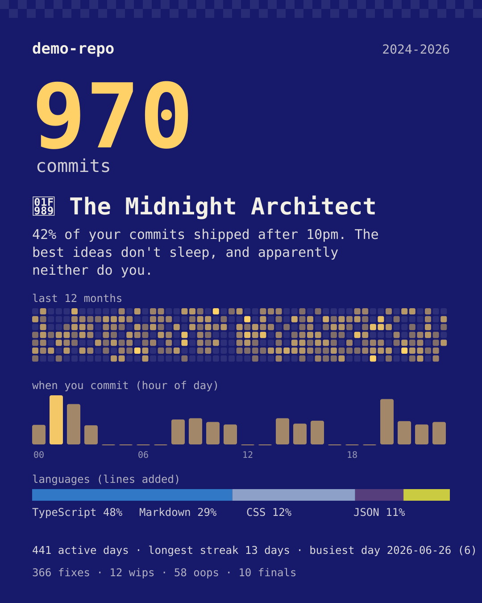
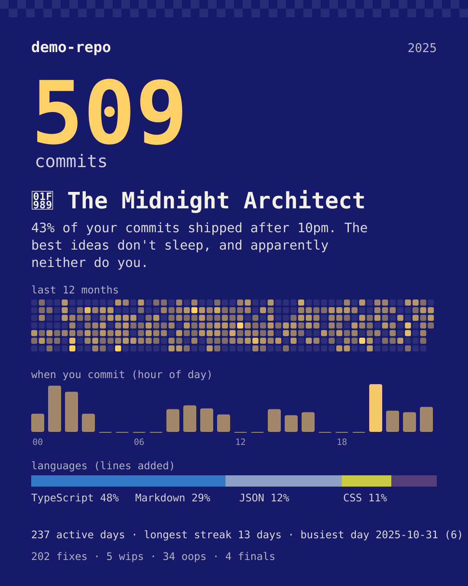
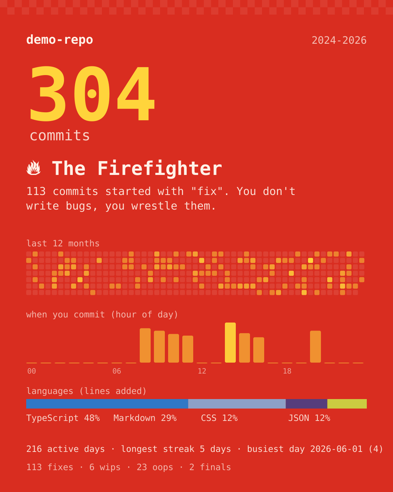
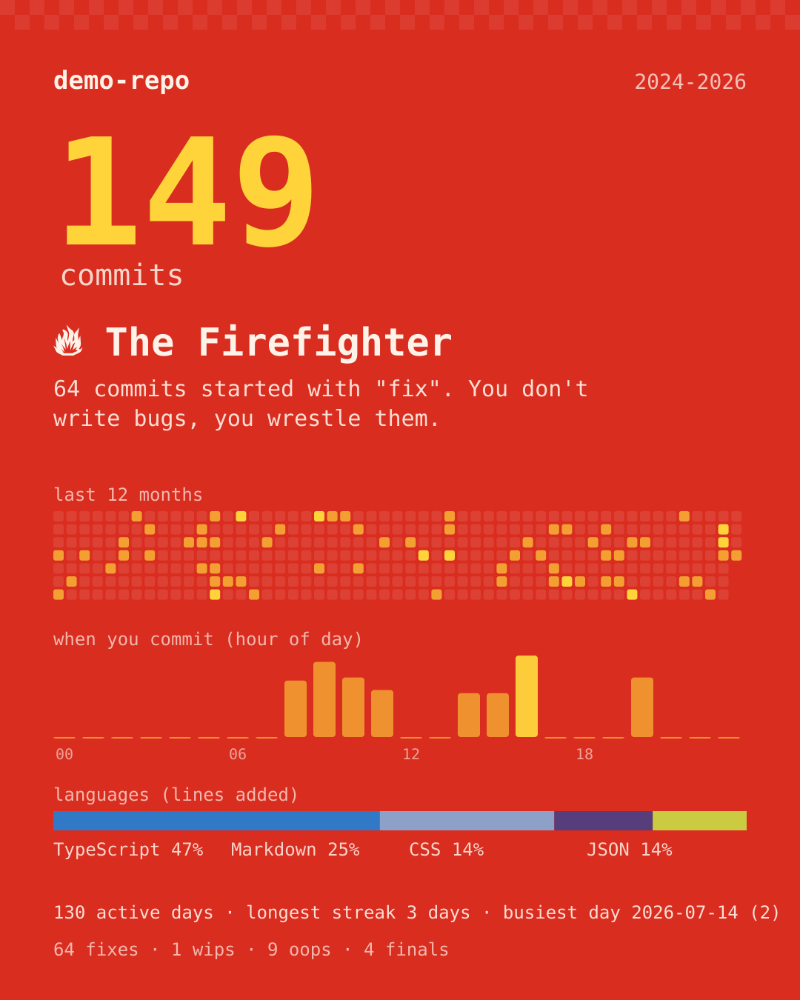

<div align="center">

# repo-wrapped

**Get a Spotify Wrapped poster of your git history: your commit personality, heatmap, power hours and languages.**

Every December people post their Spotify Wrapped. This does the same for the code you shipped: one command, one SVG you can drop into a README or post. It fuses [git-recap](https://github.com/sutharsan-311/git-recap)'s stats and verdicts with [git-wrapped](https://github.com/wheatcore/git-wrapped)'s year and profile modes, in one Python file with no dependencies.

Works with **Claude Code** and **Codex**.

 



<sub>Real output of <code>python repo_wrapped.py --demo</code> on git-recap's deterministic demo repository (three made-up authors).</sub>

</div>

## Quick start
```bash
git clone https://github.com/Dodai0419/repo-wrapped && cd repo-wrapped
python repo_wrapped.py path/to/your/repo --year 2026
```
```
  your-repo wrapped, 2026
  970 commits on 441 days, 1,045 lines added
  🦉  The Midnight Architect
  42% of your commits shipped after 10pm. The best ideas don't sleep, and apparently neither do you.

  TypeScript   ██████████             48%
  Markdown     ██████                 29%
  saved repo-wrapped.svg
```
(Numbers above are from `--demo`.)

## The problem
- Your year of work is a wall of `git log`. Nobody shares a log.
- GitHub's contribution graph shows *how often*, never *how*: night or morning, fixes or features, streaks or bursts.
- The wrapped tools that exist need Node and a browser, and render a deck you then have to screenshot.

## The solution
| Idea | Fixes |
|------|-------|
| **A verdict, not a table**: the habit your history is most unusual on, scored against a typical repo (night owl, early bird, weekend, firefighter, docs, wip, marathon streak) | "so what" stats |
| **One SVG poster** with the big number, the verdict, a 12-month heatmap, power hours and languages; the colour follows the verdict | screenshotting a web page |
| **Profile mode**: point it at `~/code` and it wraps only *your* commits (your `git config user.email`) across every repo | per-repo tools |
| **Lockfiles and vendored code don't count** as lines you wrote | a `package-lock.json` bump topping your languages |
| **Same numbers as git-recap**, checked field by field against its own published example | trusting a port |

## Gallery
All four come from the same demo repository; only the flags differ.

| `--demo` | `--year 2025` | `--author sam` | `--author jules` |
|---|---|---|---|
|  |  |  |  |
| 970 commits, night owl | one year | a daytime author: fixes win (113) | another daytime author (64 fixes) |

## Verdicts
| Verdict | Wins when |
|---|---|
| 🦉 The Midnight Architect | many commits between 22:00 and 04:59 (typical: 15%) |
| 🌅 The Dawn Deployer | many commits before 09:00 (typical: 12%) |
| ⚔️ The Weekend Warrior | many commits on Saturday and Sunday (typical: 15%) |
| 🔥 The Firefighter | many subjects start with "fix" (typical: 20%) |
| 🗺️ The Cartographer | many subjects start with "docs" (typical: 6%) |
| ✍️ The Eternal Draft | many subjects start with "wip" (typical: 2%) |
| 🏃 The Marathoner | the longest daily streak covers an unusual share of the repo's life (typical: 3%) |
| 🦾 / ⚡ fallbacks | nothing stood out: one author with 100+ commits, or a typical rhythm |

A signal only counts when there is enough data for it (its typical rate times the sample is at least 5), so 2 night commits out of 10 is not a personality.

## Usage
```bash
python repo_wrapped.py                         # the repo you are in, whole history
python repo_wrapped.py path/to/repo --year 2026
python repo_wrapped.py path/to/repo --since 2026-06-01 --until 2026-08-31
python repo_wrapped.py ~/code --year 2026      # every repo under ~/code (3 levels), only your commits
python repo_wrapped.py ~/code --all            # every repo, every author
python repo_wrapped.py path/to/repo --author "alice|bob"
python repo_wrapped.py path/to/repo --all-branches
python repo_wrapped.py path/to/repo -o me.svg  # output path (default repo-wrapped.svg)
python repo_wrapped.py path/to/repo --json     # every number
```
The date window uses the **author** date, the same date the poster buckets by, so a rebase does not move commits out of the year.

## What's in `--json`
`total`, `ins`, `del`, `activeDays`, `firstCommit`, `lastCommit`, `dailyCounts`, `hourCounts`, `weekdayCounts`, `monthCounts`, `authors`, `files` (top 5 by churn), `langs`, `longestStreak`, `currentStreak`, `busiestDay`, `busiestMonth`, `ghostCommits` (00:00-04:59), `ghostHour`, `nightPct`, `earlyPct`, `weekendPct`, `fixPct`, `docsPct`, `lingo` (wip, final, oops, fix, docs, emoji, dot, revert), `topVerbs`, `longestSubject`, `shortestSubject`, `avgPerDay`, `verdict`. The keys and values match git-recap's `recap.json`.

## Use with Claude Code
```bash
/plugin marketplace add Dodai0419/repo-wrapped
/plugin install repo-wrapped@repo-wrapped
```
Then: *"Make my 2026 git wrapped from everything in ~/code."*

## Use with Codex (ChatGPT)
```bash
git clone https://github.com/Dodai0419/repo-wrapped && cp -r repo-wrapped/skills/* ~/.codex/skills/
```
Or copy `AGENTS.md` into your project root.

## Benchmarks
Checked against git-recap's own published output: its `scripts/make-demo-repo.mjs` builds a deterministic 970-commit repository and its `example/recap.json` holds the stats for it. `make_demo_repo()` ports that script (same mulberry32 RNG, checked against Node), and `tests/` asserts that all 28 date-independent stats fields and the verdict (key, score, title, emoji) are equal (`currentStreak` depends on today's date, so it is left out).

| | git-recap 0.1.1 | git-wrapped | repo-wrapped |
|-|-|-|-|
| lines of code | 1,752 (`src/*.js`) | 834 (`src/`, `bin/`, template) | **323** (one file) |
| runtime | Node 16+ | Node | Python 3.9+, standard library |
| stats on the demo repo | `example/recap.json` | not comparable (different stats) | **identical to recap.json** |
| wrap the 970-commit demo repo (CLI, end to end) | not measured | not measured | 0.89-2.13 s (3 runs) |
| build the 970-commit demo repo | not measured (one `git add` + `git commit` per commit) | - | 1.29-1.53 s (one `git fast-import`) |

Measured on Windows 11, Python 3.11.1, git for Windows: `python repo_wrapped.py demo-repo` timed with `time.perf_counter` around a subprocess, 3 runs; `make_demo_repo()` timed in-process, 2 runs. Lines counted with `wc -l`. The upstream tools were not run on this machine, so their times are "not measured".

## Known limits
- No animated deck (git-recap has a full HTML story); the output is one static poster.
- Emoji in the SVG use the viewer's system emoji font.
- `--since/--until` compare the author date's calendar day in the author's own time zone.

## Inspired by
- [sutharsan-311/git-recap](https://github.com/sutharsan-311/git-recap) — the stats, the verdict engine and its baselines, the language table, the verdict colours and the deterministic demo repo (MIT).
- [wheatcore/git-wrapped](https://github.com/wheatcore/git-wrapped) — the year window, scanning folders of repos and defaulting to your own commits (MIT).

## Roadmap
- [ ] PNG export for platforms that do not take SVG
- [ ] A landscape 1200x630 card for link previews
- [ ] Team mode: one poster per author in a single run

## License
MIT. See `LICENSE` for the upstream copyright notices.
